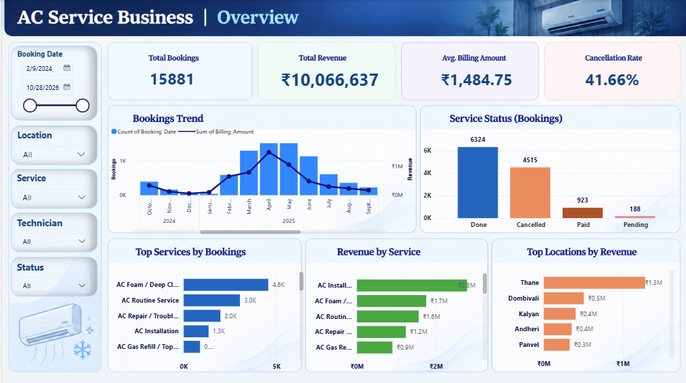

# AC Service Business Analysis

**Turning operational data into actionable business insights using SQL, Power Query and Power BI.**

## Project Overview

This project analyses AC service booking data to understand business performance, identify operational challenges, and highlight opportunities for revenue growth and customer retention.

The workflow covers data preparation, automated transformation, SQL-based analysis, and interactive Power BI reporting.

## Business Objectives

- Understand booking and revenue trends over time.
- Investigate cancellation patterns and potential lost business.
- Analyse customer retention and repeat bookings.
- Compare service and location performance.
- Evaluate technician performance using multiple operational measures.
- Identify data-quality gaps that affect business decisions.

## Tools & Technologies

- **Power Query:** Data cleaning, transformation and automated consolidation.
- **PostgreSQL / SQL:** Business analysis, aggregations and performance investigation.
- **Power BI:** Interactive reporting, KPIs and dashboard visualisation.
- **Google Sheets:** Source data integration for the refreshable pipeline.

## Analytical Approach

1. **Data preparation:** Standardise inconsistent fields, address missing or invalid values, and consolidate data from multiple periods.
2. **Data validation:** Check data completeness, consistency and the reliability of key measures.
3. **Business analysis:** Examine bookings, revenue, cancellations, customers, services, locations and technician performance.
4. **Visualisation:** Present key metrics and patterns in an interactive Power BI dashboard.
5. **Decision support:** Identify business questions that warrant further investigation and potential action.

## Key Areas of Investigation

- Declining booking volume and revenue trends.
- Cancellation rates and differences across services and locations.
- One-time versus repeat customer behaviour.
- Revenue concentration across services and locations.
- Technician performance and operational variation.
- Missing booking-status and lead-source information.

## Dashboard Preview

### Business Overview

## Key Findings

*Validated findings and their business implications will be documented here.*

## Project Structure

- `images/` — Dashboard screenshots.
- `sql/` — SQL queries used for business analysis.
- `data-cleaning/` — Data preparation methodology.
- `business-insights/` — Findings, limitations and recommendations.

## Data Privacy

The source data belongs to the business. This repository will contain only approved screenshots, sanitised examples, and analytical documentation. Confidential customer information and raw business records are not included.

## Project Status

The core data preparation pipeline and initial Power BI dashboard have been developed. Further analysis and refinements will be documented as the project progresses.
