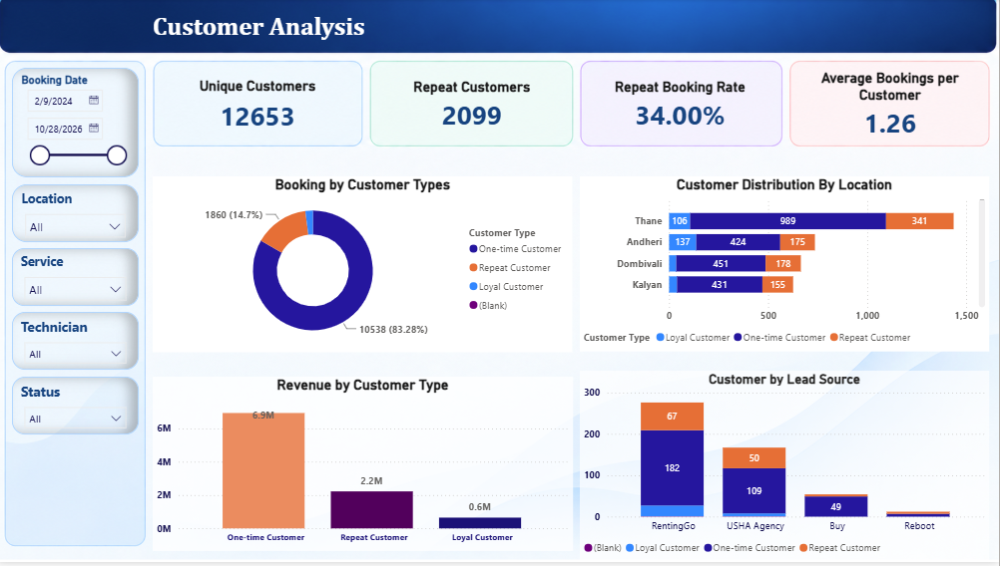
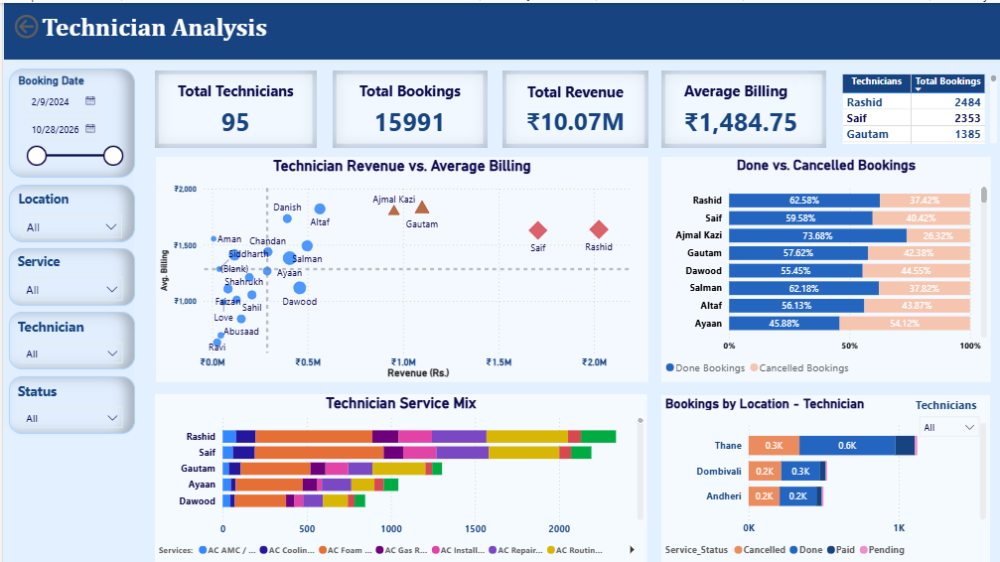

# AC Service Business Analysis

**Turning operational data into actionable business insights using SQL, Power Query and Power BI.**

## Project Overview

This project analyses AC service booking data from 2024–2026 to understand business performance, identify operational challenges, and highlight opportunities for revenue growth and customer retention.

The workflow covers data preparation, data-quality assessment, PostgreSQL analysis, and interactive Power BI reporting.

## Business Objectives

- Understand booking and revenue trends over time.
- Investigate cancellation patterns and potential lost business.
- Analyse customer retention and repeat bookings.
- Compare service and location performance.
- Evaluate technician activity using multiple operational measures.
- Identify data-quality gaps that affect business decisions.

## Tools & Technologies

- **Power Query:** Data cleaning, transformation and automated consolidation.
- **PostgreSQL / SQL:** Business analysis, aggregations and performance investigation.
- **Power BI:** Interactive reporting, KPIs and dashboard visualisation.
- **Google Sheets:** Source data integration for the refreshable pipeline.

## Analytical Approach

1. **Data preparation:** Consolidated records from multiple periods and standardised relevant fields.
2. **Data validation:** Assessed missing values, inconsistent entries and the reliability of key measures.
3. **Business analysis:** Examined bookings, revenue, cancellations, customers, services, locations and technician activity.
4. **Visualisation:** Developed interactive Power BI dashboards to explore business performance.
5. **Decision support:** Identified opportunities for further investigation and practical operational improvements.

### Workflow Automation

- Consolidated and transformed source data using Power Query to reduce repetitive manual data preparation.
- Integrated Google Sheets as the source for the reporting workflow.
- Configured scheduled refresh in Power BI Service to keep the dashboard updated from its connected data source.
- Validated the refresh process to ensure the report could retrieve updated data successfully.

**Note:** Scheduled refresh depends on the source connection, credentials, and refresh configuration remaining valid. It does not guarantee that every upstream change is automatically reflected without a successful refresh.

## Dashboard Preview

### 1. Business Overview


### 2. Customer Analysis



### 3. Technician Analysis



## Key Findings

- **Highest-revenue service:** AC Installation generated approximately ₹2.72 million in recorded revenue.
- **Customer retention opportunity:** Approximately 83.8% of identified customers were classified as one-time customers.
- **Cancellation concern:** Approximately 41.7% of bookings with a recorded outcome of Done or Cancelled were cancelled.
- **Location performance:** Thane and Dombivali were among the leading locations by total revenue, while average billing varied across locations.
- **Data-quality concern:** Missing booking statuses and incomplete lead-source information limit the reliability of some operational conclusions.

## Business Recommendations

- Investigate cancellation reasons by service and location before implementing corrective actions.
- Test customer follow-ups and seasonal maintenance reminders to encourage repeat bookings.
- Compare location revenue alongside booking volume and average billing.
- Improve booking-status, technician and lead-source recording.
- Track consistent business metrics over time to evaluate whether operational changes improve outcomes.

## Data Limitations

The stakeholder reported that the supplied records represented approximately 70% of the business. Missing or unresolved booking statuses, incomplete lead-source information, and inconsistencies in operational records limit the conclusions that can be drawn.

The cancellation rate uses only bookings marked Done or Cancelled as its denominator. It does not represent the percentage of all booking records cancelled.

Revenue is not the same as profit; cost and margin data were not available for this analysis. Findings describe the available records and should not be treated as a complete picture of overall business performance.

## Project Structure

```text
ac-service-business-analysis/
├── README.md
├── images/
│   ├── dashboard_overview.png
│   ├── customer-analysis.png
│   └── technician-analysis.png
├── sql/
│   ├── 01_data_setup_and_quality_checks.sql
│   ├── 02_booking_and_revenue_analysis.sql
│   ├── 03_customer_analysis.sql
│   ├── 04_cancellation_analysis.sql
│   ├── 05_technician_analysis.sql
│   └── 06_location_and_lead_source_analysis.sql
├── data-cleaning/
│   ├── data-preparation-methodology.md
│   └── data-quality-assessment.md
└── business-insights/
    └── findings-and-recommendations.md
```

## Data Privacy

The source data belongs to the business. This repository is intended to contain approved dashboard screenshots, SQL queries, and analytical documentation—not raw confidential records or customer-identifiable information.

## Project Status

The core data preparation workflow, SQL analysis, business insights documentation, and three Power BI dashboard pages have been developed. Further improvements may focus on data quality, analytical validation, and refining the business recommendations as more complete records become available.
